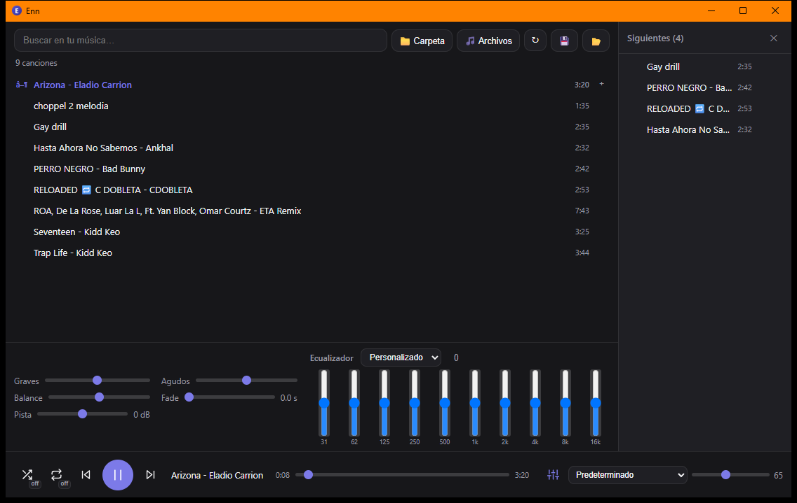

# Enn

Reproductor de música para Microsoft Windows, escrito en Rust con interfaz nativa embebida mediante Tauri. No depende de ningún servicio remoto: todo el procesamiento —decodificación, mezcla, ecualización y salida— ocurre de manera local, en el equipo del usuario.

---

## Resumen

Existen muchas aplicaciones reproductoras en el mercado y, sin embargo, sigue siendo poco frecuente encontrar una que satisfaga al mismo tiempo tres criterios: bajo consumo de memoria, soporte amplio de formatos y una interfaz de uso inmediato. Los reproductores con catálogos comerciales tienden a integrar suscripciones, telemetría y procesos auxiliares; los que apuntan a la máxima calidad sonora suelen exigir configuración previa y curvas de aprendizaje considerables.

Enn intenta un punto intermedio deliberado. Su motor de audio es un flujo en tiempo real simple: el archivo se decodifica bajo demanda, se convierte a punto flotante de 32 bits, se procesa mediante una cadena de filtros biquad y se envía al dispositivo de salida del sistema. La operación típica es exactamente la de cualquier reproductor ligero: se agrega una carpeta, se elige una canción y la reproducción comienza de inmediato.

---

## Características

| Área | Función |
|---|---|
| Formatos | MP3, FLAC, WAV, AIFF, OGG/Vorbis, Opus, M4A/AAC (decodificación por Symphonia) |
| Salida de audio | WASAPI compartido, punto flotante de 32 bits, hasta 2 canales, 48 kHz |
| Controles | Reproducir/pausar, anterior/siguiente, barra de progreso con búsqueda instantánea, volumen maestro |
| Biblioteca | Escaneo recursivo de carpetas; lectura de etiquetas (título, artista, álbum); duración calculada incluso para archivos VBR |
| Cola | Vista de las próximas pistas, con reordenamiento por clic y eliminación individual |
| Reproducción | Modo ordenado, aleatorio (shuffle) y repetición (una pista o toda la cola) |
| Mezcla | Ecualizador gráfico de 10 bandas, presets sintonizados a mano, graves/agudos, balance estéreo, fundido de transición y ganancia relativa por pista |
| Listas | Guardar y abrir playlists en formato M3U/M3U8 |
| Interfaz | Tema claro/oscuro automático según el sistema, divisor de paneles ajustable, división de ventana persistente, atajos de teclado |
| Persistencia | Biblioteca, ajustes del mezclador, cola de reproducción y ganancias por pista se conservan entre sesiones |
| Distribución | Instalador NSIS (un solo ejecutable de instalación) |

---

## Arquitectura

El proyecto se divide en dos componentes que se comunican a través del puente IP de Tauri:

1. **Núcleo de audio en Rust** (`src-tauri/src/`)
   - `decode.rs`: lectura de contenedores y decodificación de códecs mediante Symphonia; normalización a estéreo de punto flotante; medición de duración para archivos sin índice.
   - `dsp.rs`: implementación de filtros biquad según el método de RBJ (peaking, low-shelf y high-shelf), ecualizador de 10 bandas y remuestreador lineal.
   - `player.rs`: gestión del hilo de audio, cola interna de comandos y canal de eventos hacia la interfaz. Usa CPAL para la salida WASAPI.
   - `library.rs`: índice persistente de la biblioteca en JSON y soporte de playlists M3U.
2. **Interfaz de usuario web** (`ui/`)
   - Sin frameworks: HTML, CSS y JavaScript moderno.
   - Se comunica con el núcleo mediante comandos tipados `#[tauri::command]`.
   - El estado de reproducción se consulta por sondeo ligero (250 ms), lo que evita la acumulación de eventos entre procesos.

```
Archivo de audio
     │
     ▼
 Symphonia ── decodificación a PCM f32 estéreo
     │
     ▼
 ecualizador 10 bandas · tono · balance · ganancia por pista
     │
     ▼
 remuestreo a la frecuencia del dispositivo
     │
     ▼
 WASAPI compartido ── altavoces o salida elegida
```

<br>

<div align="center">

## Vista de la interfaz principal



*Figura 1. Enn en ejecución: biblioteca de la izquierda, cola de próximas pistas a la derecha y mezclador desplegado en la parte inferior. La canción «Arizona — Eladio Carrion» se encuentra en reproducción (8 segundos transcurridos de 3 minutos 20 segundos).*

</div>

---

## Decisiones de diseño

- **Punto flotante de 32 bits en toda la cadena.** Aunque el decodificador pueda producir enteros de 16 o 24 bits, la conversión inmediata a f32 evita la acumulación de errores de redondeo cuando se encadenan filtros.

- **Remuestreador lineal propio.** Para una frecuencia de 48 kHz de los dispositivos modernos y archivos a 44,1 kHz, la interpolación lineal con un remuestreo de calidad razonable es suficiente en la práctica; un remuestreador polifásico sería de mayor costo sin beneficio perceptible en la banda audible.

- **Decodificación bajo demanda, no precarga.** El decodificador solo produce los marcos que el hilo de audio necesita para el siguiente bloque de 480 muestras (10 ms a 48 kHz). Este enfoque mantiene el consumo de memoria constante, independientemente de la duración de la pista, y deja disponible el resto del sistema durante la reproducción.

- **Arquitectura de prueba automatizada.** Dos pruebas de integración —`decode_drain` y `audio_smoke`— validan la extracción completa de los marcos de un archivo WAV sintético y la reproducción real por el dispositivo de salida, respectivamente.

---

## Compilación

### Requisitos

- [Rust](https://rustup.rs) — toolchain `stable-x86_64-pc-windows-msvc`
- Visual Studio Build Tools 2022 con el componente *Desktop development with C++*
- [Node.js](https://nodejs.org) 22 o superior
- WebView2 (incluido en Windows 11; en Windows 10 se obtiene con la última actualización)

### Pasos

```bash
npm install          # instala la CLI de Tauri
npm run tauri dev    # modo desarrollo (recarga en vivo del frontend)
npm run tauri build  # instalador NSIS en src-tauri/target/release/bundle/nsis/
```

En proyectos alojados en carpetas sincronizadas (por ejemplo, OneDrive) conviene desviar el directorio de artefactos:

```powershell
$env:CARGO_TARGET_DIR = "D:\enn-target"
```

---

## Uso

1. **Abrir carpeta** — indexa toda la biblioteca y lee los metadatos de los archivos.
2. **Búsqueda** — filtra por título, artista o álbum al escribir.
3. **Reproducción** — un clic sobre una canción la pone sonando; la cola al costado muestra las siguientes.
4. **Mezclador** — el botón 🎛️ despliega ecualizador, tono, balance, fundido y ganancia por pista.

### Atajos de teclado

| Tecla | Acción |
|---|---|
| `Espacio` | Reproducir / pausar |
| `←` `→` | Canción anterior / siguiente |
| `M` | Mostrar/ocultar el mezclador |

---

## Estructura del repositorio

```
enn/
├── src-tauri/          # núcleo Rust (audio, DSP, biblioteca, playlists)
│   └── src/
│       ├── decode.rs   # decodificación de códecs con Symphonia
│       ├── dsp.rs      # filtros biquad, ecualizador, remuestreo
│       ├── player.rs   # hilo de audio y salida WASAPI
│       ├── library.rs  # índice persistente y playlists
│       └── lib.rs      # entrada de la aplicación
├── ui/                 # interfaz web (sin framework)
└── package.json        # scripts de desarrollo/build
```

---

## Estado del proyecto

La versión 0.1.0 es la primera distribución estable. Se entregó como instalador `Enn_0.1.0_x64-setup.exe`, generado con NSIS.

### Trabajo futuro

- Salida WASAPI en modo exclusivo (bit-perfect), seleccionable desde la configuración.
- Decodificación de WMA mediante FFmpeg como códec de reserva.
- Crossfade real entre pistas (superposición de audio), en contraste con el fundido que existe hoy.

---

## Licencia

Aún no definida. El código es propietario de su autor.

---

## Créditos

Enn se apoya en [Symphonia](https://github.com/pdeljanov/Symphonia) para la decodificación, [CPAL](https://github.com/RustAudio/cpal) para la salida de audio y [Tauri](https://tauri.app) como marco de aplicación de escritorio.

La música utiliza información de metadatos de los propios archivos del usuario, sin descarga externa.
